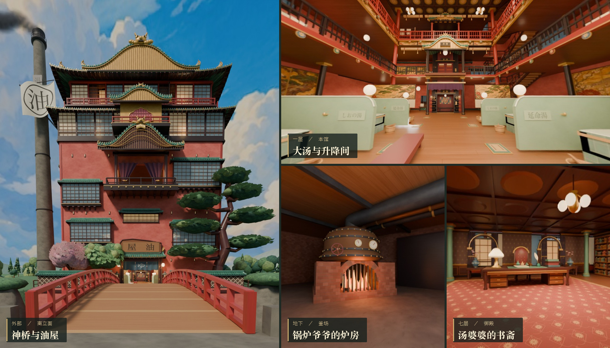

# 油屋 · Aburaya

以《千与千寻》中的油屋为参照制作的个人建筑复原习作。过朱桥进入大汤，可以沿楼梯或乘升降机，前往地下釜场、宴席和七层书斋。

## 开始漫游

**[在线进入油屋](https://mmmfory.github.io/aburaya-walkthrough/)**

下载 `index.html`，在浏览器中打开并选择「进入红桥」。模型、贴图和全景都已嵌入文件，支持离线使用。

| 操作 | 按键 |
| --- | --- |
| 移动、快步 | WASD、Shift |
| 环顾 | 鼠标移动或按住拖动 |
| 在升降间前呼梯、选层 | E |
| 打开地点图 | M |
| 切换昼夜 | L |

触屏可用左下摇杆行走，另一只手拖动环顾。地点图提供八层楼的十二个游览地点。

## Blender 工程

用 Blender 4.5 LTS 打开 `油屋.blend`。在三维视图中按 F3，搜索「步行导航」或「Walk Navigation」即可从桥头出发。

整体高度参照 1∶150 纸模型换算，从基座到塔尖约 58.5 米。正面按电影画面校准。房间深度、背面和楼层间的通道按可游览的空间推定。本项目为非官方作品。

[吉卜力官方剧照](https://www.ghibli.jp/works/chihiro/) · [さんけい油屋模型资料](https://item.rakuten.co.jp/sankeishop/mk07-10/)
